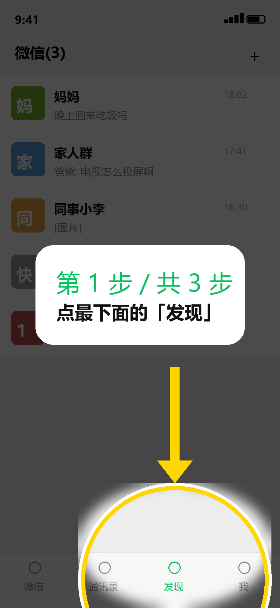

# Elder Guide · 适老化手机引导图生成器

给长辈的手机截图自动加一层「新手引导」：**整屏压暗 → 目标圆形挖亮 → 箭头 → 一句大白话**。
不需要安卓无障碍权限、不用越狱，**iOS / Android 都能用**，因为它只处理图片。



## 为什么这么做

| 想法 | 现实 |
|---|---|
| 让 AI 直接操控手机屏幕 | iOS 不允许（无系统级悬浮窗、无跨 App 无障碍），安卓要原生开发 |
| 远程协助（向日葵/ToDesk） | iOS 只能看不能控，长辈还要先学会装 App |
| **截图标注引导** | 效果等价于游戏新手引导，平台无关，当天能做完 |

把「在对方屏幕上实时画」降级成「在截图上画」，长辈按图操作、点一步发一步——
这不是妥协，这是在平台限制下找到的最短可行路径。

## 架构

```
浏览器（上传截图 / 点选目标）
   │  POST /api/ask
   ▼
本地 Python 服务（http.server，零第三方依赖）
   │  HTTP
   ▼
Dify 工作流（/v1/workflows/run）
   │  HTTP 节点
   ▼
/api/steps  →  本机 Ollama（qwen2.5:7b）

引导图渲染：Pillow（遮罩、圆形羽化挖亮、箭头、自适应文字排版）
```

**为什么拆成两半**：Dify 擅长编排与提示词，但它的代码节点没有 Pillow、也不能托管生成的图片；
图像渲染放在本地服务里更稳。两端用 HTTP 解耦，任意一半都能单独替换。

## 快速开始

```bash
# 1) 只跑本地版（不依赖 Dify）
python app.py                 # 打开 http://127.0.0.1:8765

# 2) 接 Dify（可选）
#    在 Dify 里导入 dify/elder-guide.workflow.yml，发布后创建 API Key
#    把 {"base_url": "...", "token": "app-..."} 保存为 dify.json，重启 app.py
```

Windows 用户可直接双击 `run.cmd`。

## 用法

1. 上传家人的截图（或直接用内置示例图）
2. 在图上点一下「该点的位置」
3. 点「让 AI 写步骤」，或自己填一句
4. 点「生成引导图」→ 下载发给家人

## 实现要点

- **挖亮而非叠加**：裁一块原图、高斯羽化后贴回压暗层，边缘没有硬边
- **自适应排版**：按像素宽度逐级缩字号，再按字折行，中英文都不出框
- **任意分辨率**：所有尺寸以 `max(w,h)/750` 缩放，750×1624 与 1290×2796 同样正常
- **零依赖**：只用标准库 `http.server` + Pillow
- **中文乱码坑**：Dify 的 HTTP 节点对无 `charset` 的响应会丢中文，因此 `/api/steps` 返回
  `text/plain; charset=utf-8`

## Roadmap

- [ ] 接视觉模型（GLM-4V / Qwen-VL）自动定位目标控件，去掉人工点选
- [ ] 多步连续引导：一次生成 3 张图，拼长图发微信
- [ ] 部署到公网（HuggingFace Spaces），做成可点开的在线 demo

## License

MIT
